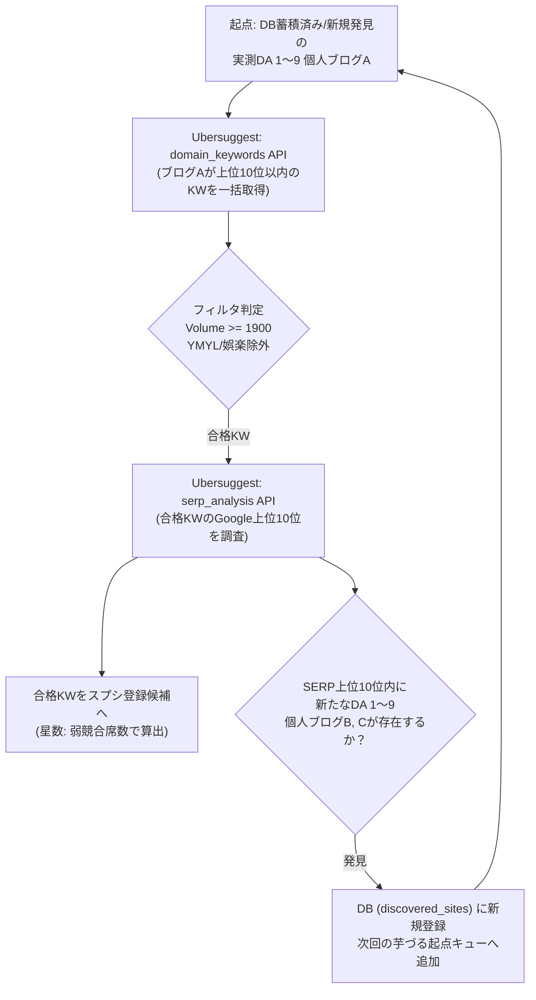

# 個人ブログ起点・芋づる式（ポテトディグ）リサーチプロトコル

## 1. 目的と基本思想
本スキルは、キーワードからの絨毯爆撃（空振り率90%以上）を完全排除し、
**「実測DA 1〜9の個人ブログ」を起点として、個人ブログ同士の生息地を数珠つなぎに辿る（芋づる式）**ことで、
Ubersuggest APIの消費枠（約1,500回/日）の範囲内で最大の当たりキーワード（月間1,900以上、☆☆☆過半数）を収穫する。

---

## 2. 厳格な4大絶対ルール（ハルシネーション完全排除）

1. **実測エビデンス主義（推測の絶対禁止）**:
   - 行登録の主語となるブログは、Ubersuggest API生レスポンスにて `domainAuthority` が **1〜9** であることが証明された独立個人ブログのみ。
   - AI（エージェント）による「個人ブログらしい」「個人が書いたっぽい」という推測判定での登録は厳禁。
2. **需要と順位の生データフィルタ**:
   - 抽出するキーワードは、API生データで `volume >= 1900` かつ `position <= 10`（1〜10位以内）を満たすものに限定。
3. **ノイズ・脱線防止**:
   - `guard_check_entertainment_kw.ps1`（マンガ・アニメ・芸能・映画等）および `guard_check_ymyl_kw.ps1`（病気・治療・投資・法律等）による機械的フィルタを必ず通過させること。
4. **黄金比率（50:25:25）と3者突合の維持**:
   - ☆☆☆以上が50%以上、☆☆と☆がそれぞれ25%以下。
   - 終了時は必ず `tools\sheet_reconcile.ps1` を実行し、Passed: true（違反0件）を確認すること。

---

## 3. 芋づる探索の具体的ステップ

### ステップ1: 起点個人ブログの選定
- SQLiteの `discovered_sites` テーブルから、まだ `domain_keywords` を実行していない「実測DA 1〜9」の個人ブログを1件取り出す。

### ステップ2: ブログ持ちネタの一括抽出（`domain_keywords`）
- Ubersuggest API `domain_keywords` を実行し、そのブログが `position <= 10`（1〜10位）にランクインしているオーガニックキーワード一覧を取得。
- 月間検索ボリューム `volume >= 1900` のキーワードを抽出。

### ステップ3: 当たり判定と星数算出（`serp_analysis`）
- 抽出されたKWに対して `serp_analysis`（上位10位調査）を実行。
- 上位10位以内の「個人ブログ ＋ 弱競合UGC（知恵袋・note等）」の席数をカウントし、星数（☆〜☆☆☆☆☆）を決定。
- 黄金比率（☆☆☆ 50%以上）に適合する場合、スプレッドシートへコミット。

### ステップ4: 次の個人ブログの収穫（芋づる連鎖）
- ステップ3のSERP上位10位の中に、**新たな実測DA 1〜9の独立個人ブログ（ブログB、ブログC）** が見つかった場合、直ちに `discovered_sites` に保存。
- 次の探索サイクルで、今度はブログBやCを起点にしてステップ1から繰り返す（完全な数珠つなぎ）。

---

## 4. 実行コマンド
本スキルに基づく芋づる探索は、以下の正規ツールを通じてのみ実行される：
`powershell -ExecutionPolicy Bypass -File tools\run_pipeline.ps1 -Gender <both|female|male>`
